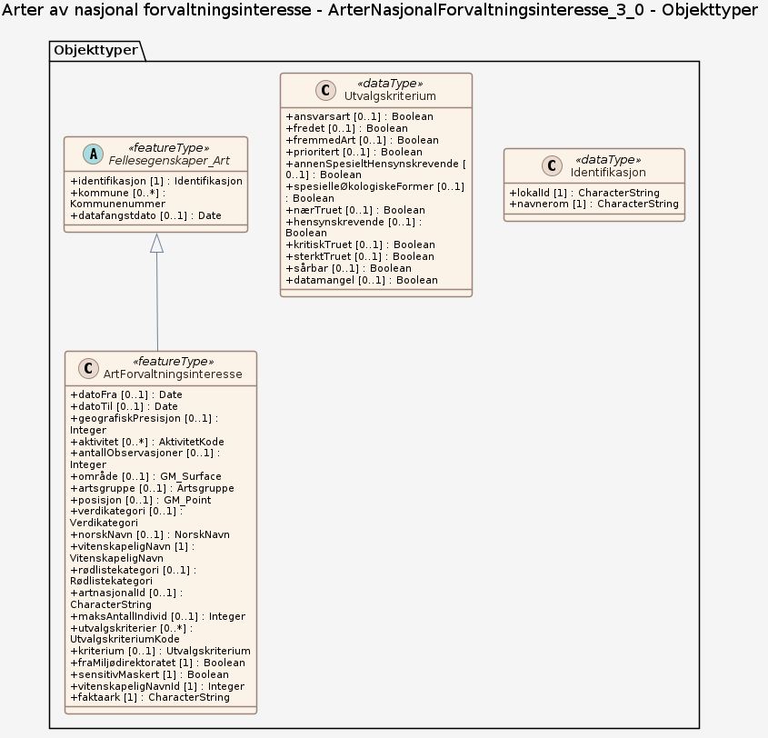

### Datamodell

**Kilde:** [SOSI UML XMI-fil](https://sosi.geonorge.no/svn/SOSI/SOSI%20Del%203/Miljodirektoratet/ArterNasjonalForvaltningsinteresse_3_0.xml)

#### ArtForvaltningsinteresse

Forekomster/observasjoner av et kriteriebasert utvalg arter som er spesielt viktig for biologisk mangfold, samt fremmede arter som er en trussel mot naturlig biologisk mangfold. Alt innhold hentes fra Artsdatabankens infrastruktur, basert på arten og nærmere definerte tekniske kvalitetskriterier (geografisk presisjon mv.).

Egenskaper

<table class="feature-attribute-table">
  <thead>
    <tr>
      <th>Egenskap</th>
      <th>Beskrivelse</th>
      <th>Type</th>
      <th>Multiplisitet</th>
    </tr>
  </thead>
  <tbody>
    <tr>
      <td>dato<wbr />Fra</td>
      <td>Startdato for registreringen</td>
      <td>Date</td>
      <td>0..1</td>
    </tr>
    <tr>
      <td>dato<wbr />Til</td>
      <td>Sluttdato for registreringen</td>
      <td>Date</td>
      <td>0..1</td>
    </tr>
    <tr>
      <td>geografisk<wbr />Presisjon</td>
      <td>Angis i hele meter og kan representere forskjellige forståelser av geografisk presisjon, avhengig av hvordan originaldata er etablert. Generelt for flater vil gjelde at presisjon er et uttrykk for observatørens oppfatning av hvor nøyaktig objektet er geografisk avgrenset/omsluttet på kart i forhold til de faktiske forhold i terrenget. Dette vil også gjelde punktdata i en rekke tilfeller. For punktdata er presisjonen avstanden (radius) mellom midtpunktkoordinatene for det observerte objektet og yttergrensa for det arealet (sirkelflaten) som punktet representerer.</td>
      <td>Integer</td>
      <td>0..1</td>
    </tr>
    <tr>
      <td>aktivitet</td>
      <td>angir type aktivitet som er knyttet til observasjonen/forekomsten. Er bare aktuelt for arter som er mobile og kan ha flere ulike aktiviteter, f.eks. fugl.</td>
      <td><a href="#kodeliste-aktivitetkode">Aktivitet<wbr />Kode</a> (kodeliste)</td>
      <td>0..*</td>
    </tr>
    <tr>
      <td>antall<wbr />Observasjoner</td>
      <td>Antall observasjoner</td>
      <td>Integer</td>
      <td>0..1</td>
    </tr>
    <tr>
      <td>område</td>
      <td>objektets utstrekning - artsdata område, for eksempel</td>
      <td>GM_<wbr />Surface</td>
      <td>0..1</td>
    </tr>
    <tr>
      <td>artsgruppe</td>
      <td>Angivelse av  hvilken artsgruppe arten tilhører</td>
      <td><a href="#kodeliste-artsgruppe">Artsgruppe</a> (kodeliste)</td>
      <td>0..1</td>
    </tr>
    <tr>
      <td>posisjon</td>
      <td>sted som objektet eksisterer på - artsdata punkt, kan være enkeltobservasjoner eller registreringer</td>
      <td>GM_<wbr />Point</td>
      <td>0..1</td>
    </tr>
    <tr>
      <td>verdikategori</td>
      <td>Angivelse av forvaltningskategori</td>
      <td><a href="#kodeliste-verdikategori">Verdikategori</a> (kodeliste)</td>
      <td>0..1</td>
    </tr>
    <tr>
      <td>norsk<wbr />Navn</td>
      <td>Norsk navn på arten</td>
      <td><a href="#kodeliste-norsknavn">Norsk<wbr />Navn</a> (kodeliste)</td>
      <td>0..1</td>
    </tr>
    <tr>
      <td>vitenskapelig<wbr />Navn</td>
      <td>Vitenskapelig navn</td>
      <td><a href="#kodeliste-vitenskapelignavn">Vitenskapelig<wbr />Navn</a> (kodeliste)</td>
      <td>1</td>
    </tr>
    <tr>
      <td>rødlistekategori</td>
      <td>statuskoder hentet fra Norsk Rødliste for arter og Fremmedartslista</td>
      <td><a href="#kodeliste-rødlistekategori">Rødlistekategori</a> (kodeliste)</td>
      <td>0..1</td>
    </tr>
    <tr>
      <td>artnasjonal<wbr />Id</td>
      <td>Ulike kriterier for utvalg</td>
      <td>Character<wbr />String</td>
      <td>0..1</td>
    </tr>
    <tr>
      <td>maks<wbr />Antall<wbr />Individ</td>
      <td></td>
      <td>Integer</td>
      <td>0..1</td>
    </tr>
    <tr>
      <td>utvalgskriterier</td>
      <td></td>
      <td><a href="#kodeliste-utvalgskriteriumkode">Utvalgskriterium<wbr />Kode</a> (kodeliste)</td>
      <td>0..*</td>
    </tr>
    <tr>
      <td>kriterium</td>
      <td></td>
      <td>Utvalgskriterium (datatype)</td>
      <td>0..1</td>
    </tr>
    <tr>
      <td>- ansvarsart</td>
      <td>Ansvarsart; Norge har mer enn 25% av arten europeiske bestand</td>
      <td>Boolean</td>
      <td>0..1</td>
    </tr>
    <tr>
      <td>- fredet</td>
      <td>Fredet art i medhold av naturmangfoldloven</td>
      <td>Boolean</td>
      <td>0..1</td>
    </tr>
    <tr>
      <td>- fremmed<wbr />Art</td>
      <td>Fremmed art i Fremmedartslista (Artsdatabanken); kategoriene Svært høy risiko (SH) og Høy risiko (HI)</td>
      <td>Boolean</td>
      <td>0..1</td>
    </tr>
    <tr>
      <td>- prioritert</td>
      <td>Prioritert art i medhold av naturmangfoldloven</td>
      <td>Boolean</td>
      <td>0..1</td>
    </tr>
    <tr>
      <td>- annen<wbr />Spesielt<wbr />Hensynskrevende</td>
      <td>Annen spesielt hensynskrevende art; andre arter av nasjonal forvaltningsinteresse, utvalgt av Miljødirektoratet</td>
      <td>Boolean</td>
      <td>0..1</td>
    </tr>
    <tr>
      <td>- spesielle<wbr />Økologiske<wbr />Former</td>
      <td>Spesiell økologisk form; former eller underarter av arter av nasjonal forvaltningsinteresse som ikke vurderes i rødlisten</td>
      <td>Boolean</td>
      <td>0..1</td>
    </tr>
    <tr>
      <td>- nær<wbr />Truet</td>
      <td>Truet art i Norsk rødliste for arter, Norge (Artsdatabanken); kategoriene Kritisk truet (CR), Sterkt truet (EN) og Sårbar (VU)</td>
      <td>Boolean</td>
      <td>0..1</td>
    </tr>
    <tr>
      <td>- hensynskrevende</td>
      <td></td>
      <td>Boolean</td>
      <td>0..1</td>
    </tr>
    <tr>
      <td>- kritisk<wbr />Truet</td>
      <td></td>
      <td>Boolean</td>
      <td>0..1</td>
    </tr>
    <tr>
      <td>- sterkt<wbr />Truet</td>
      <td></td>
      <td>Boolean</td>
      <td>0..1</td>
    </tr>
    <tr>
      <td>- sårbar</td>
      <td></td>
      <td>Boolean</td>
      <td>0..1</td>
    </tr>
    <tr>
      <td>- datamangel</td>
      <td></td>
      <td>Boolean</td>
      <td>0..1</td>
    </tr>
    <tr>
      <td>fra<wbr />Miljødirektoratet</td>
      <td></td>
      <td>Boolean</td>
      <td>1</td>
    </tr>
    <tr>
      <td>sensitiv<wbr />Maskert</td>
      <td></td>
      <td>Boolean</td>
      <td>1</td>
    </tr>
    <tr>
      <td>vitenskapelig<wbr />Navn<wbr />Id</td>
      <td></td>
      <td>Integer</td>
      <td>1</td>
    </tr>
    <tr>
      <td>faktaark</td>
      <td>Lenke til faktaark</td>
      <td>Character<wbr />String</td>
      <td>1</td>
    </tr>
    <tr class="inherited-from">
      <th colspan="4" scope="rowgroup">Arvet fra Fellesegenskaper_Art</th>
    </tr>
    <tr>
      <td>identifikasjon</td>
      <td>unik identifikasjon av et objekt</td>
      <td>Identifikasjon (datatype)</td>
      <td>1</td>
    </tr>
    <tr>
      <td>- lokal<wbr />Id</td>
      <td>lokal identifikator av et objekt  Merknad: Det er dataleverendørens ansvar å sørge for at den lokale identifikatoren er unik innenfor navnerommet.</td>
      <td>Character<wbr />String</td>
      <td>1</td>
    </tr>
    <tr>
      <td>- navnerom</td>
      <td>navnerom som unikt identifiserer datakilden til et objekt, anbefales å være en http-URI  Eksempel: <a href="http://data.geonorge.no/SentraltStedsnavnsregister/1.0">http://data.geonorge.no/SentraltStedsnavnsregister/1.0</a>  Merknad : Verdien for nanverom vil eies av den dataprodusent som har ansvar for de unike identifikatorene og må være registrert i data.geonorge.no eller data.norge.no</td>
      <td>Character<wbr />String</td>
      <td>1</td>
    </tr>
    <tr>
      <td>kommune</td>
      <td>nummerering av kommuner i henhold til SSB sin offisielle liste  Merknad: Det presiseres at kommune alltid skal ha 4 siffer, dvs. eventuelt med ledende null. Kommune benyttes for kopling mot en rekke andre registre som også benytter 4 siffer.</td>
      <td><a href="#kodeliste-kommunenummer">Kommunenummer</a> (kodeliste)</td>
      <td>0..*</td>
    </tr>
    <tr>
      <td>datafangstdato</td>
      <td></td>
      <td>Date</td>
      <td>0..1</td>
    </tr>
  </tbody>
</table>

Relasjoner

**Arv**
Fellesegenskaper_Art

#### Fellesegenskaper_Art (abstrakt)

abstrakt objekt som bærer en rekke egenskaper som er fagområde-uavhengige og kan benyttes for naturtype

Egenskaper

<table class="feature-attribute-table">
  <thead>
    <tr>
      <th>Egenskap</th>
      <th>Beskrivelse</th>
      <th>Type</th>
      <th>Multiplisitet</th>
    </tr>
  </thead>
  <tbody>
    <tr>
      <td>identifikasjon</td>
      <td>unik identifikasjon av et objekt</td>
      <td>Identifikasjon (datatype)</td>
      <td>1</td>
    </tr>
    <tr>
      <td>- lokal<wbr />Id</td>
      <td>lokal identifikator av et objekt  Merknad: Det er dataleverendørens ansvar å sørge for at den lokale identifikatoren er unik innenfor navnerommet.</td>
      <td>Character<wbr />String</td>
      <td>1</td>
    </tr>
    <tr>
      <td>- navnerom</td>
      <td>navnerom som unikt identifiserer datakilden til et objekt, anbefales å være en http-URI  Eksempel: <a href="http://data.geonorge.no/SentraltStedsnavnsregister/1.0">http://data.geonorge.no/SentraltStedsnavnsregister/1.0</a>  Merknad : Verdien for nanverom vil eies av den dataprodusent som har ansvar for de unike identifikatorene og må være registrert i data.geonorge.no eller data.norge.no</td>
      <td>Character<wbr />String</td>
      <td>1</td>
    </tr>
    <tr>
      <td>kommune</td>
      <td>nummerering av kommuner i henhold til SSB sin offisielle liste  Merknad: Det presiseres at kommune alltid skal ha 4 siffer, dvs. eventuelt med ledende null. Kommune benyttes for kopling mot en rekke andre registre som også benytter 4 siffer.</td>
      <td><a href="#kodeliste-kommunenummer">Kommunenummer</a> (kodeliste)</td>
      <td>0..*</td>
    </tr>
    <tr>
      <td>datafangstdato</td>
      <td></td>
      <td>Date</td>
      <td>0..1</td>
    </tr>
  </tbody>
</table>

### Kodelister

#### «CodeList» AktivitetKode

**Definisjon:** angir type aktivitet som er knyttet til observasjonen/forekomsten. Er bare aktuelt for arter som er mobile og kan ha flere ulike aktiviteter, f.eks. fugl.

Koder

<table class="code-list-table">
  <thead>
    <tr>
      <th>Kodenavn:</th>
      <th>Definisjon:</th>
      <th>Kodeverdi:</th>
    </tr>
  </thead>
  <tbody>
    <tr>
      <td>stasjonær</td>
      <td></td>
      <td></td>
    </tr>
    <tr>
      <td>muligReproduksjon</td>
      <td></td>
      <td></td>
    </tr>
    <tr>
      <td>næringssøkende</td>
      <td></td>
      <td></td>
    </tr>
    <tr>
      <td>reproduksjon</td>
      <td></td>
      <td></td>
    </tr>
    <tr>
      <td>forflytting</td>
      <td></td>
      <td></td>
    </tr>
    <tr>
      <td>død</td>
      <td></td>
      <td></td>
    </tr>
  </tbody>
</table>

#### «CodeList» Artsgruppe

**Definisjon:** angir typen organisme i henhold til en forvaltningsmessig fornuftig inndeling

Profilparametre i tagged values

<table class="feature-attribute-table">
  <colgroup>
    <col style="width: 35%;" />
    <col style="width: 65%;" />
  </colgroup>
  <tbody>
    <tr>
      <th scope="row">asDictionary</th>
      <td>false</td>
    </tr>
  </tbody>
</table>

Koder

<table class="code-list-table">
  <thead>
    <tr>
      <th>Kodenavn:</th>
      <th>Definisjon:</th>
      <th>Kodeverdi:</th>
    </tr>
  </thead>
  <tbody>
    <tr>
      <td>fugler</td>
      <td></td>
      <td></td>
    </tr>
    <tr>
      <td>karplanter</td>
      <td></td>
      <td></td>
    </tr>
    <tr>
      <td>sopper</td>
      <td></td>
      <td></td>
    </tr>
    <tr>
      <td>insekter</td>
      <td></td>
      <td></td>
    </tr>
    <tr>
      <td>laver</td>
      <td></td>
      <td></td>
    </tr>
    <tr>
      <td>fisker</td>
      <td></td>
      <td></td>
    </tr>
    <tr>
      <td>krepsdyr</td>
      <td></td>
      <td></td>
    </tr>
    <tr>
      <td>moser</td>
      <td></td>
      <td></td>
    </tr>
    <tr>
      <td>pattedyr</td>
      <td></td>
      <td></td>
    </tr>
    <tr>
      <td>øvrigeDyr</td>
      <td></td>
      <td></td>
    </tr>
    <tr>
      <td>alger</td>
      <td></td>
      <td></td>
    </tr>
    <tr>
      <td>edderkoppdyr</td>
      <td></td>
      <td></td>
    </tr>
    <tr>
      <td>amfibierOgReptiler</td>
      <td></td>
      <td></td>
    </tr>
    <tr>
      <td>biller</td>
      <td></td>
      <td></td>
    </tr>
    <tr>
      <td>bløtdyr</td>
      <td></td>
      <td></td>
    </tr>
    <tr>
      <td>koralldyr</td>
      <td></td>
      <td></td>
    </tr>
    <tr>
      <td>mangefotinger</td>
      <td></td>
      <td></td>
    </tr>
    <tr>
      <td>nebbmunner</td>
      <td></td>
      <td></td>
    </tr>
    <tr>
      <td>nettvinger</td>
      <td></td>
      <td></td>
    </tr>
    <tr>
      <td>rettvinger</td>
      <td></td>
      <td></td>
    </tr>
    <tr>
      <td>sekkedyr</td>
      <td></td>
      <td></td>
    </tr>
    <tr>
      <td>sommerfugler</td>
      <td></td>
      <td></td>
    </tr>
    <tr>
      <td>tovinger</td>
      <td></td>
      <td></td>
    </tr>
    <tr>
      <td>vepser</td>
      <td></td>
      <td></td>
    </tr>
    <tr>
      <td>øyenstikkere</td>
      <td></td>
      <td></td>
    </tr>
  </tbody>
</table>

#### «CodeList» Verdikategori

**Definisjon:** kategorisering i ulike grader av forvaltningsinteresse. Inndelingen følger av utvalgskriteriene, slik at hvert utvalgskriterium medfører en bestemt forvaltningskategori.

Profilparametre i tagged values

<table class="feature-attribute-table">
  <colgroup>
    <col style="width: 35%;" />
    <col style="width: 65%;" />
  </colgroup>
  <tbody>
    <tr>
      <th scope="row">asDictionary</th>
      <td>false</td>
    </tr>
  </tbody>
</table>

Koder

<table class="code-list-table">
  <thead>
    <tr>
      <th>Kodenavn:</th>
      <th>Definisjon:</th>
      <th>Kodeverdi:</th>
    </tr>
  </thead>
  <tbody>
    <tr>
      <td>storVerdi</td>
      <td></td>
      <td></td>
    </tr>
    <tr>
      <td>noeVerdi</td>
      <td></td>
      <td></td>
    </tr>
    <tr>
      <td>sværtStorVerdi</td>
      <td></td>
      <td></td>
    </tr>
    <tr>
      <td>middelsVerdi</td>
      <td></td>
      <td></td>
    </tr>
  </tbody>
</table>

#### «CodeList» NorskNavn

**Definisjon:** kodelisten eies og vedlikeholdes av Artsdatabanken og er tilgjengelig som tjeneste "WS_Artsnavnebase" på <a href="http://www2.artsdatabanken.no/artsnavn/Contentpages/Webservices.aspx"><http://www2.artsdatabanken.no/artsnavn/Contentpages/Webservices.aspx></a>

Profilparametre i tagged values

<table class="feature-attribute-table">
  <colgroup>
    <col style="width: 35%;" />
    <col style="width: 65%;" />
  </colgroup>
  <tbody>
    <tr>
      <th scope="row">asDictionary</th>
      <td>true</td>
    </tr>
  </tbody>
</table>

#### «CodeList» VitenskapeligNavn

**Definisjon:** kodelisten eies og vedlikeholdes av Artsdatabanken og er tilgjengelig som tjeneste "WS_Artsnavnebase" på <a href="http://www2.artsdatabanken.no/artsnavn/Contentpages/Webservices.aspx"><http://www2.artsdatabanken.no/artsnavn/Contentpages/Webservices.aspx></a>

Profilparametre i tagged values

<table class="feature-attribute-table">
  <colgroup>
    <col style="width: 35%;" />
    <col style="width: 65%;" />
  </colgroup>
  <tbody>
    <tr>
      <th scope="row">asDictionary</th>
      <td>true</td>
    </tr>
    <tr>
      <th scope="row">codeList</th>
      <td><a href="http://skjema.geonorge.no/SOSI/produktspesifikasjon/ArterNasjonalForvaltningsinteresse-2.0/VitenskapeligNavn">http://skjema.geonorge.no/SOSI/produktspesifikasjon/ArterNasjonalForvaltningsinteresse-2.0/VitenskapeligNavn</a></td>
    </tr>
  </tbody>
</table>

#### «CodeList» Rødlistekategori

**Definisjon:** statuskoder hentet fra Norsk Rødliste for arter

Profilparametre i tagged values

<table class="feature-attribute-table">
  <colgroup>
    <col style="width: 35%;" />
    <col style="width: 65%;" />
  </colgroup>
  <tbody>
    <tr>
      <th scope="row">asDictionary</th>
      <td>false</td>
    </tr>
  </tbody>
</table>

Koder

<table class="code-list-table">
  <thead>
    <tr>
      <th>Kodenavn:</th>
      <th>Definisjon:</th>
      <th>Kodeverdi:</th>
    </tr>
  </thead>
  <tbody>
    <tr>
      <td>Datamangel</td>
      <td></td>
      <td></td>
    </tr>
    <tr>
      <td>Kritisk truet</td>
      <td></td>
      <td></td>
    </tr>
    <tr>
      <td>Livskraftig</td>
      <td></td>
      <td></td>
    </tr>
    <tr>
      <td>Nær truet</td>
      <td></td>
      <td></td>
    </tr>
    <tr>
      <td>Regionalt utdødd</td>
      <td></td>
      <td></td>
    </tr>
    <tr>
      <td>Ikke Vurdert</td>
      <td></td>
      <td></td>
    </tr>
    <tr>
      <td>Sterkt truet</td>
      <td></td>
      <td></td>
    </tr>
    <tr>
      <td>Sårbar</td>
      <td></td>
      <td></td>
    </tr>
  </tbody>
</table>

#### «CodeList» UtvalgskriteriumKode

**Definisjon:** Ulike kriterier for utvalg

Koder

<table class="code-list-table">
  <thead>
    <tr>
      <th>Kodenavn:</th>
      <th>Definisjon:</th>
      <th>Kodeverdi:</th>
    </tr>
  </thead>
  <tbody>
    <tr>
      <td>ansvarsart</td>
      <td>Ansvarsart; Norge har mer enn 25% av arten europeiske bestand</td>
      <td></td>
    </tr>
    <tr>
      <td>fredet</td>
      <td>Fredet art i medhold av naturmangfoldloven</td>
      <td></td>
    </tr>
    <tr>
      <td>fremmedArt</td>
      <td>Fremmed art i Fremmedartslista (Artsdatabanken);
kategoriene Svært høy risiko (SH) og Høy risiko (HI)</td>
      <td></td>
    </tr>
    <tr>
      <td>prioritert</td>
      <td>Prioritert art i medhold av naturmangfoldloven</td>
      <td></td>
    </tr>
    <tr>
      <td>annenSpesieltHensynskrevende</td>
      <td>Annen spesielt hensynskrevende art; andre arter av nasjonal forvaltningsinteresse, utvalgt av Miljødirektoratet</td>
      <td></td>
    </tr>
    <tr>
      <td>spesielleØkologiskeFormer</td>
      <td>Spesiell økologisk form; former eller underarter av arter av nasjonal forvaltningsinteresse som ikke vurderes i rødlisten</td>
      <td></td>
    </tr>
    <tr>
      <td>nærTruet</td>
      <td>Truet art i Norsk rødliste for arter, Norge (Artsdatabanken); kategoriene Kritisk truet (CR), Sterkt truet (EN) og Sårbar (VU)</td>
      <td></td>
    </tr>
    <tr>
      <td>hensynskrevende</td>
      <td></td>
      <td></td>
    </tr>
    <tr>
      <td>kritiskTruet</td>
      <td></td>
      <td></td>
    </tr>
    <tr>
      <td>sterktTruet</td>
      <td></td>
      <td></td>
    </tr>
    <tr>
      <td>sårbar</td>
      <td></td>
      <td></td>
    </tr>
    <tr>
      <td>datamangel</td>
      <td></td>
      <td></td>
    </tr>
  </tbody>
</table>

#### «CodeList» Kommunenummer

**Definisjon:** nummerering av kommuner i henhold til Statistisk sentralbyrå sin offisielle liste samt et utvalg av utgåtte numre

Merknad: Det presiseres at kommune alltid skal ha 4 sifre, dvs. eventuelt med ledende null. Kommune benyttes for kopling mot en rekke andre registre som også benytter 4 sifre.

Profilparametre i tagged values

<table class="feature-attribute-table">
  <colgroup>
    <col style="width: 35%;" />
    <col style="width: 65%;" />
  </colgroup>
  <tbody>
    <tr>
      <th scope="row">asDictionary</th>
      <td>true</td>
    </tr>
    <tr>
      <th scope="row">codeList</th>
      <td><a href="http://register.geonorge.no/sosi-kodelister/kommunenummer.xml">http://register.geonorge.no/sosi-kodelister/kommunenummer.xml</a></td>
    </tr>
  </tbody>
</table>
